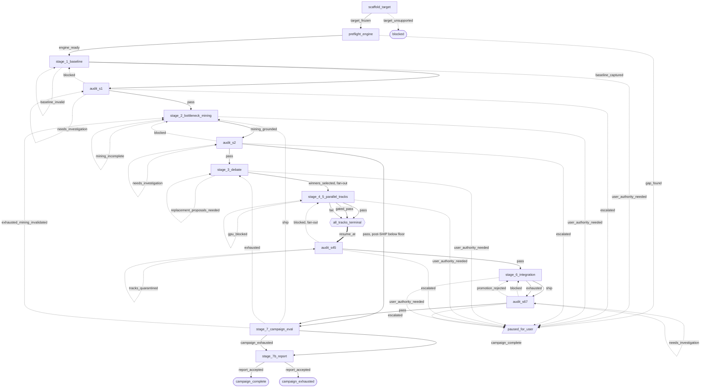

# ammo

AMMO as a plugin for Claude Code and for Codex. It runs a staged, multi-agent optimization campaign on your own GPU host,
inside a Pumice checkout. It makes the frozen production inference target
measurably faster and ships only changes that are active in production,
correct, and statistically faster.

This README is a rendered view of the package, not an authority. The graph
(`workflow.pave.yaml`, at the head of `revisions.yaml`), the lead skill
(`skills/ammo/SKILL.md`), the role contracts (`agents/*.md` and
`codex/agents/*.toml`), and the live state contract
(`schemas/state.schema.json` and `scripts/transitions.json`) stay the source of
truth.

## 1. What it does, and for whom

For an engineer who wants a model's latency on a fixed GPU, dtype,
parallelism, and workload pushed down without a human driving each step. One
campaign does this:

1. Freeze the target and check the pre-built engine.
2. Capture a clean baseline and a separate profile.
3. Mine where the time goes.
4. Let 2-4 champion agents propose and debate candidates.
5. Build each winner in its own worktree through five binding gates.
6. Integrate the exact validated set and promote it as the new baseline.
7. Repeat from step 3 until the mechanical stop rule fires, then write a
   fact-checked `REPORT.md`.

An independent auditor checks the work after stages 1, 2, 4-5, and 6-7. The
lead never implements a change and never judges its own claim.

v1 ships and tests the CUDA path only.

## 2. Install

The plugin is the directory that holds this README. It runs on either harness.

**Claude Code.** Add the marketplace that lists this package and install it.
The role agents (`agents/*.md`), the two skills (`ammo:ammo` and
`ammo:ammo-report`), and the campaign hooks (`hooks/hooks.json`) register with
the plugin, and `/hooks` lists the hooks:

```text
/plugin marketplace add jinhuang12/pave
/plugin install ammo@jinhuang12-plugins
```

Then seed the revision folder (step 7 below).

**Codex.**

1. Add this package to a configured local Codex marketplace, then install it:

   ```bash
   codex plugin add ammo@<marketplace>
   ```

2. Install the custom agents into your Pumice checkout:

   ```bash
   python3 /path/to/ammo/codex/install_agents.py --project /path/to/pumice-checkout
   ```

3. Trust the checkout. Accept the Codex trust prompt, or add this to
   `~/.codex/config.toml`:

   ```toml
   [projects."/absolute/path/to/pumice-checkout"]
   trust_level = "trusted"
   ```

4. Turn on hooks and native multi-agent work in the checkout's
   `.codex/config.toml`, with the settings that `codex/RUNTIME.md` lists.

5. Verify the installed agents, then restart Codex in the checkout:

   ```bash
   python3 /path/to/ammo/codex/install_agents.py --project /path/to/pumice-checkout --check
   ```

6. Open `/hooks`, review the registered campaign hooks, and trust them when
   their paths match this package.

7. Both harnesses: seed the checkout's revision folder from the package once,
   then verify it. The folder records which graph revision your campaigns run
   under; a campaign itself runs from its `state.json`.

   ```bash
   python3 /path/to/ammo/scripts/record_revision.py install /path/to/pumice-checkout/.ammo/evolution --from /path/to/ammo
   python3 /path/to/ammo/scripts/record_revision.py verify /path/to/pumice-checkout/.ammo/evolution
   ```

`scripts/validate_pave.py` and `scripts/record_revision.py` need `pyyaml` and
`jsonschema` and fail closed without them.

## 3. What you build before the first campaign

The plugin does not build the engine. Preflight checks the first five items
below and pauses the campaign, naming the gap, when one is missing.

| Item | What it must be |
|---|---|
| GPU host | NVIDIA GPUs, the driver, and `nvidia-smi` on PATH |
| Pumice checkout | at the commit `scripts/pumice_pins.py` pins; the campaign runs inside it |
| Rust build | `cargo build --release` done in that checkout |
| Engine venv | default `<checkout>/.venv`, with `pumice` and `pumice_rust` importable |
| Model weights | a plain model directory that holds `config.json` (not the HF cache layout) |
| Python | 3.11 or later for the plugin scripts |
| Test battery | `uv`, or `pytest`, `pyyaml`, `jsonschema`, `pydantic`, `httpx`, `numpy` |

Check the venv by hand with
`<checkout>/.venv/bin/python -c "import pumice, pumice_rust"`. The model and
GPU must be ones Pumice can run; `references/workload-invocation.md` lists the
supported architectures and GPU families.

Run the test battery from the plugin root:

```bash
uv run --no-project --with pytest --with pyyaml --with jsonschema --with pydantic --with httpx --with numpy python -m pytest tests -q -m "not neuron and not requires_gpu"
```

## 4. Start a campaign

Start Claude Code or Codex in the Pumice checkout and invoke the lead skill with
your target. On Claude Code:

```text
/ammo:ammo --model-id <model-dir> --hardware <gpu> --dtype <dtype> --tp <tp> --batch-sizes 1 8 32 --input-len 64 --output-len 512
```

On Codex, invoke `$ammo:ammo` with the same flags. Give only the parameters you
want to set. The lead scaffolds the campaign once with
`scripts/ammo new_target.py` and the flags you gave; every flag you omit takes
the default in `references/workload-invocation.md`. That file also owns the
other flags: `--isl-osl`, `--max-model-len`, `--max-num-seqs`,
`--max-num-batched-tokens`, `--prompt-source`, `--data-parallel-size`,
`--enable-expert-parallel`, and `--serving-manifest` for a serving target. Pass
`--campaign-id` to choose the id; otherwise the scaffold mints one.

After the scaffold, `target.json`, `state.json`, and `rounds/1/constraints.md`
are the frozen target. A change to a frozen parameter needs your approval.

A campaign takes hours and runs without you. It pauses only when you ask,
when preflight finds a gap, when an audit escalation finds a campaign-wide
blocker, or when a stage needs authority only you hold. To resume, invoke
`/ammo:ammo` again in the same checkout. The lead finds the campaign through
the `.ammo/active` marker and continues from the last verified gate in
`state.json`.

## 5. Campaign workspace

One campaign lives in one directory inside the Pumice checkout:

```text
<pumice-checkout>/
  .ammo/
    active                      # one line: the current campaign id
    evolution/                  # revision folder (Install, step 7)
    <campaign-id>/              # YYYYMMDD-HHMMSS-<6 hex>
      target.json               # frozen target and bench config
      state.json                # live run state (lead writes only)
      REPORT.md  report_assets/ # Stage 7b deliverable
      blockers/                 # escalation records
      rounds/<N>/
        constraints.md
        profiling/  sweeps/  mining/  debate/  tracks/<op_id>/  audits/
  .claude/worktrees/<name>/     # one isolated worktree per implementation track
```

- The campaign id is the value of every `session_id` field and flag in the
  scripts and state.
- The scaffold writes `.ammo/active` and adds `.ammo/` to
  `<checkout>/.git/info/exclude` once, so campaign files stay out of git.
- The marker is a pointer and is never cleared. Whether a campaign is live
  comes from `campaign.status` in its `state.json`.
- `references/artifact-layout.md` owns every path under a round.

The live run state is `.ammo/<campaign-id>/state.json`, governed by
`schemas/state.schema.json` and `scripts/transitions.json` through
`scripts/ammo_state.py`. The graph governs design and review; `state.json`
governs a run.

## 6. GPU ownership

`scripts/gpu_reservation.py` is the only GPU lock. Its lease table lives in the
host-wide directory `/tmp/ammo_gpu_res`. The pool is every GPU that
`nvidia-smi` lists; a reservation request also respects the caller's
`CUDA_VISIBLE_DEVICES` when it is set. Each lease belongs to one campaign id, so
two campaigns on one host can never hold the same GPU. Agents never use a GPU
they did not reserve, and never stop a process they do not own.

Check the leases with `scripts/gpu_reservation.py status --table`.
`references/gpu-pool.md` owns the rules, including how to clear the stale leases
of a crashed campaign.

## 7. Hooks

The plugin registers campaign hooks only. Outside a campaign every hook exits
at once with no output. See [hooks/README.md](hooks/README.md) for each hook,
the guarantee it gives, and the hooks the server version had that this plugin
drops.

## 8. Workflow graph

`scripts/validate_pave.py workflow.pave.yaml` reports:

```text
PASS workflow.pave.yaml: 13 nodes, 47 edges, 5 control nodes
```

The 13 nodes and 47 edges map one to one onto the stages, audits, and gates of
the lead skill. Stage node ids are `stage_` plus the stage name in
`scripts/transitions.json`. The five binding gates (5.1a, 5.1b, 5.2, 5.3a,
5.3b) are checks on the edges that leave a passing track. The Stage 7 stop
rule is the check `stop_rule_met`: stop only when `top_addressable_e2e_pct` is
below `min_e2e_improvement_pct`.

Solid arrows are the forward path. Dotted arrows are loops, repairs, and
pauses. The thick arrow is the join's resume point, not one of the 47 edges.



| Endpoint | Kind | Meaning |
|---|---|---|
| `campaign_complete` | terminal, accepted | stop rule fired after an audited SHIP |
| `campaign_exhausted` | terminal, exhausted | stop rule fired after an exhausted round |
| `blocked` | terminal, blocked | target cannot run; nothing scaffolded |
| `paused_for_user` | pause | state kept; resume continues the campaign |
| `all_tracks_terminal` | join | Stage 6 barrier: every track is terminal |

## 9. Not in v1

- Neuron. The `pumice-neuron` and `vllm-neuron` profiles are refused at scaffold
  and preflight. The Neuron code paths stay in the scripts, but this package
  does not ship or test them, and it does not bundle the Neuron skills.
- The `eval/` harness and the role-play agent prompts of the source tree.
- Server features: the web UI, the archive store, remote pause and resume,
  multi-host GPU pools, and the container image install. A pause here is the
  lead's own state-driven pause and resume.
